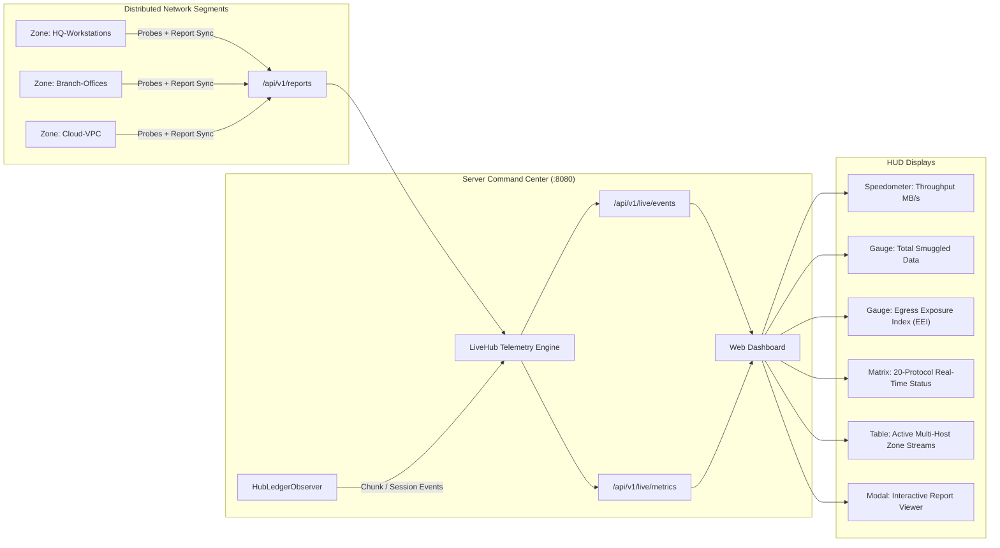

# Command Center HUD and Live Dashboard

Contraband includes an embedded, zero-CDN, real-time command center dashboard server. It visualizes streaming exfiltration throughput, active sessions, multi-zone connectivity feeds, and report synchronization.



---

## 1. Starting the Command Center

To launch the dashboard server on port 8080:

```bash
# Standalone server
contraband-server --dashboard :8080 --bind 0.0.0.0

# Unified binary
contraband server --live-dashboard :8080 --bind 0.0.0.0
```

Access the interface in any standard browser:
```
http://<server-ip>:8080/dashboard
```

---

## 2. API Endpoints

The dashboard server exposes the following REST and streaming endpoints:

| Endpoint | Method | Content-Type | Description |
| :--- | :--- | :--- | :--- |
| `/dashboard` | `GET` | `text/html` | Embedded single-file web dashboard UI. Zero external CDN dependencies. |
| `/api/v1/live/events` | `GET` | `text/event-stream` | Server-Sent Events (SSE) bus broadcasting real-time chunk progress, throughput, and session state. |
| `/api/v1/live/metrics` | `GET` | `application/json` | Full JSON snapshot of global metrics, protocol states, active streams, and zone summaries. |
| `/api/v1/reports` | `GET` | `application/json` | Lists all client assessment reports stored in memory. |
| `/api/v1/reports` | `POST` | `application/json` | Ingests client reports uploaded via `--sync-report`. |
| `/api/v1/reports/{id}/html` | `GET` | `text/html` | Serves the standalone interactive HTML assessment report for the specified run. |
| `/api/v1/reports/{id}/sarif`| `GET` | `application/json` | Serves the SARIF v2.1.0 security finding artifact for automated SIEM/DevSecOps ingestion. |

---

## 3. Real-Time Telemetry Synchronization

Clients upload completed assessments and real-time findings to the dashboard using `--sync-report`:

```bash
contraband-client \
  --server 198.51.100.1 \
  --ports 8443 \
  --protocols web \
  --zone "Production-DMZ" \
  --sync-report http://198.51.100.1:8080
```

When synchronized:
1. Active transfer throughput and chunk indicators light up in the HUD in real-time.
2. The global Egress Exposure Index (EEI) updates dynamically.
3. The report is added to the Reports tab with one-click access to interactive HTML, JSON, and SARIF exports.
