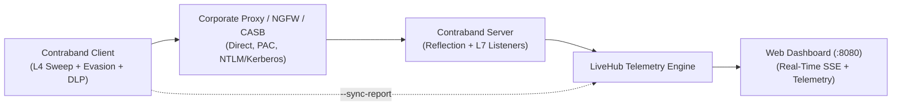

# Contraband Operator Wiki

Welcome to the **Contraband** technical reference and operator wiki. Contraband is a pure Go (`CGO_ENABLED=0`) egress assessment engine designed for authorized red teams, purple teams, and network defenders to evaluate perimeter filtering, corporate proxy enforcement, and Data Loss Prevention (DLP) controls.

---

## Wiki Navigation Index

| Document | Description |
| :--- | :--- |
| **[Installation and Build](Installation-and-Build.md)** | Cross-compilation matrix for Linux, macOS, and Windows across AMD64/ARM64. |
| **[Quickstart Guide](Quickstart-Guide.md)** | 30-second operational execution guides for standalone and unified binaries. |
| **[Protocols Reference](Protocols-Reference.md)** | Detailed breakdown of all 20+ supported L4, L7, DNS, SMB, Cloud, and Covert egress protocols. |
| **[Proxy Traversal and Evasion](Proxy-Traversal-and-Evasion.md)** | PAC discovery, NTLM/Kerberos authentication, uTLS fingerprint mimicry, and traffic pacing. |
| **[Synthetic DLP Verification](Synthetic-DLP-Verification.md)** | Mathematical specifications for Luhn PCI-DSS cards, SSN/NINO/SIN, HL7/FHIR, and cloud API keys. |
| **[Command Center HUD](Command-Center-HUD.md)** | Real-time SSE event bus, telemetry metrics schema, zero-CDN web dashboard, and report ingestion. |
| **[Soak Testing and Benchmarks](Soak-Testing-and-Benchmarks.md)** | 3.18 TB continuous soak test results, memory invariant (<32MB), and hardware sizing guidelines. |

---

## Core Operational Invariants

| Invariant | Specification | Guarantee |
| :--- | :--- | :--- |
| Runtime Independence | Pure Go (`CGO_ENABLED=0`) | Compiles to static single-file binaries with no libc, python, or external library requirements. |
| Bounded Memory | Deterministic `<32 MB` Heap | Streaming iterators and pooled buffers prevent heap exhaustion regardless of transfer size (50 KB to 10 TB). |
| Port Non-Interference | Probe before binding | Listeners verify port availability; active system services are skipped without disruption. |
| Measurement Precision | Sub-millisecond timing | L4 sweeps, proxy handshakes, and L7 chunk ACKs record duration with millisecond precision (`0.00ms`). |
